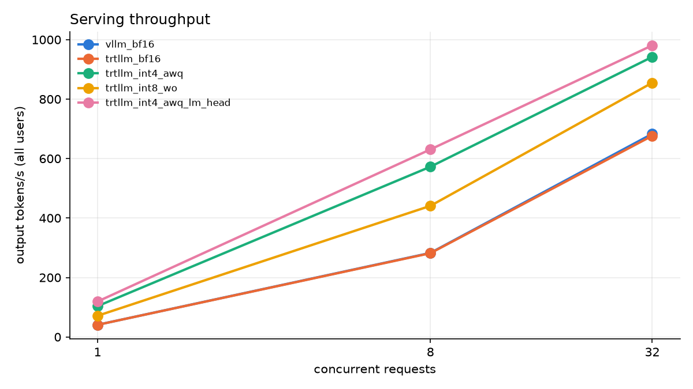
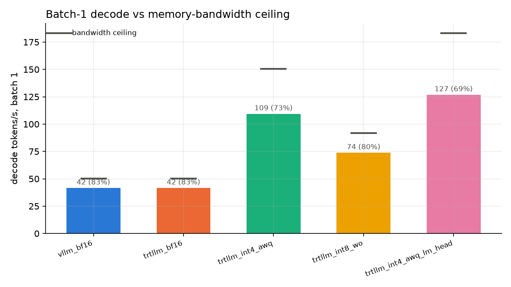

# Deployment benchmarks: Qwen/Qwen3-8B

Workload: 1024 input / 256 output tokens (random, `--ignore-eos`), `vllm bench serve` against `/v1/completions` for every engine. `c1_tok_s` = 1000 / TPOT at concurrency 1; ceiling = 768 GB/s / (weights − embedding table + KV cache at mid-sequence).

| server                  | engine   | fmt              |   disk_gb |   server_gpu_gb |   kv_tokens |   startup_s |   decode_ceiling_tok_s |   c1_tok_s |   c1_%ceiling |   c1_ttft_ms |   c8_out_tok_s |   c8_tpot_ms |   c8_ttft_ms |   c32_out_tok_s |   c32_tpot_ms |   c32_ttft_ms |
|:------------------------|:---------|:-----------------|----------:|----------------:|------------:|------------:|-----------------------:|-----------:|--------------:|-------------:|---------------:|-------------:|-------------:|----------------:|--------------:|--------------:|
| vllm_bf16               | vllm     | bf16             |      16.4 |            37   |      145440 |          45 |                   50.2 |       41.6 |          82.8 |        130.7 |          282.6 |         26.7 |        430.2 |           683.2 |          42.1 |        1199.5 |
| trtllm_bf16             | trtllm   | bf16             |      16.4 |            36.6 |      150336 |          45 |                   50.2 |       41.6 |          82.8 |        148.9 |          281.7 |         26.6 |        474.2 |           676.6 |          40.5 |        1764.7 |
| trtllm_int4_awq         | trtllm   | int4_awq         |       6.2 |            34.6 |      205280 |         110 |                  150.4 |      109.4 |          72.7 |        137   |          572.5 |         11.7 |        603.5 |           941.9 |          26.4 |        1947   |
| trtllm_int8_wo          | trtllm   | int8_wo          |       9.4 |            35.4 |      188224 |         120 |                   91.8 |       73.8 |          80.4 |        135.5 |          440.9 |         16.3 |        482.1 |           855.1 |          30.2 |        1865.2 |
| trtllm_int4_awq_lm_head | trtllm   | int4_awq_lm_head |       5.3 |            34.4 |      210720 |         240 |                  183.1 |      126.8 |          69.3 |        136.8 |          630.7 |         10.4 |        598.5 |           980.7 |          25.2 |        1907.9 |

## Real-kernel accuracy (gsm8k, through the server)

`fake_quant` = the same format in the PTQ study (HF, simulated). Differences within ~2 stderr are noise.

| server                  | fmt              |   server |   stderr |   fake_quant |   diff |
|:------------------------|:-----------------|---------:|---------:|-------------:|-------:|
| vllm_bf16               | bf16             |    88.1  |     0.89 |        87.95 |   0.15 |
| trtllm_bf16             | bf16             |    88.48 |     0.88 |        87.95 |   0.53 |
| trtllm_int4_awq         | int4_awq         |    86.58 |     0.94 |        86.88 |  -0.3  |
| trtllm_int8_wo          | int8_wo          |    88.25 |     0.89 |        88.4  |  -0.15 |
| trtllm_int4_awq_lm_head | int4_awq_lm_head |    86.81 |     0.93 |        86.58 |   0.23 |

## Where a batch-1 decode step goes (Nsight Systems, ms per token)

TensorRT-LLM, 64 tokens after warm-up. In the INT4 run, `gemm_bf16` is the BF16 `lm_head` (one GEMV per step); `elementwise` is AWQ's `x * pre_quant_scale` before `o_proj` / `down_proj`.

| server                  |   gpu_ms_per_step |   gemm_bf16 |   attention |   norm |   activation |   elementwise |   sampling |   other |   gemm_int4 |
|:------------------------|------------------:|------------:|------------:|-------:|-------------:|--------------:|-----------:|--------:|------------:|
| trtllm_bf16             |             24.05 |       23.12 |        0.57 |   0.27 |         0.06 |          0.02 |       0.01 |    0.01 |        0    |
| trtllm_int4_awq         |              8.86 |        1.78 |        0.61 |   0.29 |         0.06 |          0.12 |       0.01 |    0.01 |        5.98 |
| trtllm_int4_awq_lm_head |              7.51 |        0    |        0.56 |   0.3  |         0.06 |          0.12 |       0.01 |    0.01 |        6.46 |

