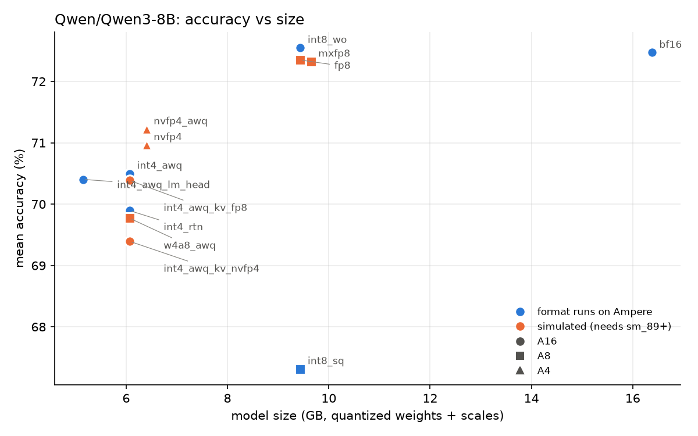

# PTQ study: Qwen/Qwen3-8B

Calibration: `cnn_dailymail-128x512`. Accuracy in %, WikiText as word perplexity (lower is better). `avg` = mean accuracy over the lm-eval tasks, `avg_vs_bf16` = difference from BF16 in points.

| fmt               |   wikitext |   arc_challenge |   hellaswag |   winogrande |   mmlu |   gsm8k |   avg |   avg_vs_bf16 |   weight_gb |   bits_per_param |   act_bits |   kv_bits | deployable_on_ampere   |
|:------------------|-----------:|----------------:|------------:|-------------:|-------:|--------:|------:|--------------:|------------:|-----------------:|-----------:|----------:|:-----------------------|
| bf16              |      14.59 |           56.23 |       74.92 |        68.27 |  74.99 |   87.95 | 72.47 |          0    |       16.38 |            16    |         16 |        16 | yes                    |
| int4_awq          |      15.4  |           52.13 |       73.59 |        67.09 |  72.8  |   86.88 | 70.5  |         -1.97 |        6.07 |             5.93 |         16 |        16 | yes                    |
| int8_sq           |      16.11 |           52.47 |       71.81 |        67.4  |  66.64 |   78.24 | 67.31 |         -5.16 |        9.44 |             9.22 |          8 |        16 | yes                    |
| int8_wo           |      14.56 |           56.48 |       74.94 |        68.03 |  74.89 |   88.4  | 72.55 |          0.08 |        9.44 |             9.22 |         16 |        16 | yes                    |
| int4_rtn          |      15.71 |           53.33 |       73.24 |        66.54 |  72.06 |   84.31 | 69.89 |         -2.58 |        6.07 |             5.93 |         16 |        16 | yes                    |
| fp8               |      14.58 |           57.08 |       74.98 |        67.48 |  75.02 |   87.19 | 72.35 |         -0.12 |        9.44 |             9.22 |          8 |        16 | simulated              |
| nvfp4             |      15.19 |           55.38 |       73.07 |        66.93 |  72.79 |   86.66 | 70.96 |         -1.51 |        6.4  |             6.25 |          4 |        16 | simulated              |
| nvfp4_awq         |      15.22 |           55.29 |       73.46 |        67.48 |  73.3  |   86.58 | 71.22 |         -1.25 |        6.4  |             6.25 |          4 |        16 | simulated              |
| w4a8_awq          |      15.64 |           51.62 |       73.35 |        65.67 |  72.69 |   85.52 | 69.77 |         -2.7  |        6.07 |             5.93 |          8 |        16 | simulated              |
| mxfp8             |      14.65 |           56.14 |       74.82 |        68.19 |  74.6  |   87.87 | 72.33 |         -0.14 |        9.65 |             9.43 |          8 |        16 | simulated              |
| int4_awq_kv_fp8   |      15.57 |           52.13 |       73.32 |        67.17 |  72.58 |   86.73 | 70.39 |         -2.08 |        6.07 |             5.93 |         16 |         8 | simulated              |
| int4_awq_kv_nvfp4 |      15.92 |           50.68 |       73.43 |        66.85 |  71.85 |   84.15 | 69.39 |         -3.08 |        6.07 |             5.93 |         16 |         4 | simulated              |
| int4_awq_lm_head  |      15.71 |           52.13 |       73.6  |        66.85 |  72.85 |   86.58 | 70.4  |         -2.07 |        5.15 |             5.03 |         16 |        16 | yes                    |

## Calibration ablation

|                                                                         |   wikitext |   arc_challenge |   hellaswag |   winogrande |   mmlu |   gsm8k |    avg |
|:------------------------------------------------------------------------|-----------:|----------------:|------------:|-------------:|-------:|--------:|-------:|
| ('int4_awq', 'cnn_dailymail-128x512')                                   |      15.4  |           52.13 |       73.59 |        67.09 |  72.8  |   86.88 |  70.5  |
| ('int4_awq', 'cnn_dailymail-32x512')                                    |      15.42 |          nan    |      nan    |       nan    |  73.29 |   85.6  | nan    |
| ('int4_awq', 'cnn_dailymail-512x512')                                   |      15.37 |          nan    |      nan    |       nan    |  73.03 |   86.96 | nan    |
| ('int4_awq', 'nemotron-math-v2-128x512-chat')                           |      15.45 |          nan    |      nan    |       nan    |  72.84 |   85.75 | nan    |
| ('int4_awq', 'nemotron-sft-instruction-following-chat-v2-128x512-chat') |      15.29 |          nan    |      nan    |       nan    |  72.82 |   86.28 | nan    |
| ('int8_sq', 'cnn_dailymail-128x512')                                    |      16.11 |           52.47 |       71.81 |        67.4  |  66.64 |   78.24 |  67.31 |
| ('int8_sq', 'cnn_dailymail-32x512')                                     |      18.72 |          nan    |      nan    |       nan    |  57.7  |   57.85 | nan    |
| ('int8_sq', 'cnn_dailymail-512x512')                                    |      15.44 |          nan    |      nan    |       nan    |  70    |   81.88 | nan    |
| ('int8_sq', 'nemotron-math-v2-128x512-chat')                            |      27.63 |          nan    |      nan    |       nan    |  53.36 |   78.09 | nan    |
| ('int8_sq', 'nemotron-sft-instruction-following-chat-v2-128x512-chat')  |      16.43 |          nan    |      nan    |       nan    |  67.78 |   80.74 | nan    |

