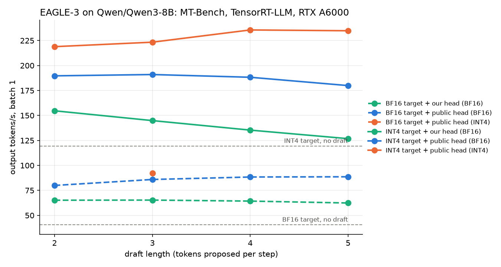

# Speculative decoding: Qwen/Qwen3-8B

MT-Bench (80 questions * 2 turns), batch 1, greedy, thinking off, TensorRT-LLM 1.0 via ModelOpt's specdec_bench. `acceptance_length` = tokens produced per target forward pass; `step_ms` = time per step (draft + verify).

| target           | draft                |   draft_length |   acceptance_length |   step_ms |   output_tok_s |   speedup_vs_target |   speedup_vs_bf16 |
|:-----------------|:---------------------|---------------:|--------------------:|----------:|---------------:|--------------------:|------------------:|
| bf16             | eagle3_own           |              2 |                1.8  |      27.4 |          65.17 |                1.6  |              1.6  |
| bf16             | eagle3_own           |              3 |                1.92 |      29   |          65.3  |                1.61 |              1.61 |
| bf16             | eagle3_own           |              4 |                1.97 |      30.2 |          64.29 |                1.58 |              1.58 |
| bf16             | eagle3_own           |              5 |                1.99 |      31.4 |          62.39 |                1.54 |              1.54 |
| bf16             | eagle3_tengyunw      |              2 |                2.19 |      27.3 |          79.96 |                1.97 |              1.97 |
| bf16             | eagle3_tengyunw      |              3 |                2.49 |      28.8 |          85.93 |                2.11 |              2.11 |
| bf16             | eagle3_tengyunw      |              4 |                2.68 |      30   |          88.4  |                2.17 |              2.17 |
| bf16             | eagle3_tengyunw      |              5 |                2.81 |      31.2 |          88.63 |                2.18 |              2.18 |
| bf16             | eagle3_tengyunw_int4 |              3 |                2.46 |      26.5 |          92.26 |                2.27 |              2.27 |
| bf16             | none                 |              0 |                1    |      24.6 |          40.65 |                1    |              1    |
| int4_awq_lm_head | eagle3_own           |              2 |                1.8  |      11.5 |         154.69 |                1.29 |              3.81 |
| int4_awq_lm_head | eagle3_own           |              3 |                1.92 |      13   |         144.88 |                1.21 |              3.56 |
| int4_awq_lm_head | eagle3_own           |              4 |                1.97 |      14.3 |         135.34 |                1.13 |              3.33 |
| int4_awq_lm_head | eagle3_own           |              5 |                2    |      15.5 |         126.79 |                1.06 |              3.12 |
| int4_awq_lm_head | eagle3_tengyunw      |              2 |                2.18 |      11.4 |         189.67 |                1.59 |              4.67 |
| int4_awq_lm_head | eagle3_tengyunw      |              3 |                2.5  |      12.9 |         190.98 |                1.6  |              4.7  |
| int4_awq_lm_head | eagle3_tengyunw      |              4 |                2.7  |      14.1 |         188.25 |                1.58 |              4.63 |
| int4_awq_lm_head | eagle3_tengyunw      |              5 |                2.82 |      15.3 |         179.92 |                1.51 |              4.43 |
| int4_awq_lm_head | eagle3_tengyunw_int4 |              2 |                2.17 |       9.9 |         218.88 |                1.83 |              5.39 |
| int4_awq_lm_head | eagle3_tengyunw_int4 |              3 |                2.44 |      10.8 |         223.37 |                1.87 |              5.5  |
| int4_awq_lm_head | eagle3_tengyunw_int4 |              4 |                2.67 |      11.1 |         235.61 |                1.97 |              5.8  |
| int4_awq_lm_head | eagle3_tengyunw_int4 |              5 |                2.78 |      11.5 |         234.81 |                1.97 |              5.78 |
| int4_awq_lm_head | none                 |              0 |                1    |       8.4 |         119.49 |                1    |              2.94 |

## Where a speculative decoding step goes (Nsight Systems, ms per step)

`scripts/split_specdec_profile.py`: medians over one 256-token generation; `target` = verifying the draft, `draft` = all draft passes (incl. its BF16 `fc`), `idle` = GPU waiting on the host.

| profile                     |   step |   draft |   draft_fc |   target |   idle |
|:----------------------------|-------:|--------:|-----------:|---------:|-------:|
| int4_lm_head_eagle3_int4_k4 |  10.71 |    1.64 |       0.17 |     7.87 |    1.2 |
